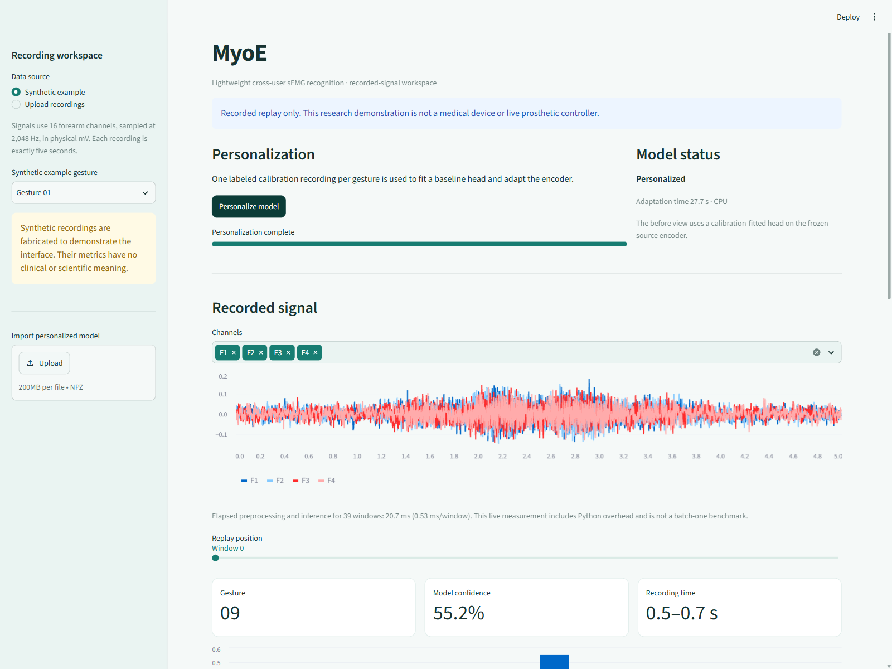

# MyoE

**Lightweight cross-user sEMG gesture recognition and personalization.** MyoE adapts a source-pretrained convolutional encoder to a user's labeled calibration recordings and reconstructs a 16-gesture classifier. It runs on CPU and takes 16 forearm channels.

This research prototype operates on recorded sEMG. It has not been clinically validated and does not control a prosthesis or connect to live hardware.



## Architecture


The source encoder contains 7,968 parameters. A personalized model contains 9,008 including its affine head. Personalization performs 2,000 updates on labeled calibration examples, then refits the final head using only calibration examples. The source checkpoint requires a fitted head before prediction.

## Install and run

Create a Python 3.11–3.14 virtual environment, install the project, and start the recorded-signal demo.

```powershell
python -m venv .venv
.\.venv\Scripts\Activate.ps1
python -m pip install torch --index-url https://download.pytorch.org/whl/cpu
python -m pip install -e '.[demo,test]'
streamlit run demo/app.py
```

On Linux, activate with `source .venv/bin/activate` before running the same pip and Streamlit commands. The CPU PyTorch index avoids installing GPU runtime dependencies. See the [demo guide](docs/demo.md) for supported file formats.

## Python API

```python
import numpy as np
from myoe import load_pretrained, preprocess, personalize, predict_recording, save_model, load_model

source = load_pretrained()
# One 5-second, 2048 Hz recording per gesture, with channels F1–F16
# in order and samples in physical millivolts.
recordings = np.load("calibration.npy", allow_pickle=False)  # (16, 10240, 16)
windows = np.concatenate([preprocess(recording) for recording in recordings])
labels = np.repeat(np.arange(1, 17), 39)
model = personalize(source, windows, labels, seed=2101)
query = np.load("query.npy", allow_pickle=False)             # (10240, 16)
prediction = predict_recording(model, query)
print(prediction["labels"], prediction["probabilities"])
save_model(model, "personalized.npz")
restored = load_model("personalized.npz")
```

Preprocessing crops each recording to `[0.5, 4.5)` seconds, forms 200 ms windows at 100 ms strides, and computes 20 RMS bins per channel. Each recording yields 39 windows. Recordings must match the sampling rate, units and channel order described in [technical details](docs/technical.md).

## Evidence and scope

The Session 1 exploratory study and prospective Session 2 study used 18 source participants and 25 separate target participants. Session 2 involved the same targets on a later day. Its participant-level mean macro-F1 for E was 0.6846 with one calibration repetition and 0.7786 with three. These are averages across draws and seeds, not measured results for a single shipped seed. See the [model card](docs/model-card.md) and [benchmark record](docs/benchmarks.md).

An earlier CPU test of E reported a 0.481 ms median for preprocessing and inference per window on one development laptop and a personalized payload of 43,781 bytes. That historical measurement used a 12-source E checkpoint, one support window and one CPU thread. Package-specific measurements and their conditions are recorded in [release verification](docs/release-verification.md). Actual timings depend on the machine and numerical libraries.

On the same Ryzen 5 development laptop, the packaged E-18 implementation took a median 0.849 ms for one synthetic window including preprocessing and probability inference. One single-threaded synthetic calibration run took 19.03 seconds for the full 2,000 updates and final-head fit. The personalized NPZ contained 9,008 parameters and occupied 42,800 bytes. These are software measurements on fabricated inputs, not recognition results. See [release verification](docs/release-verification.md) for p95 and measurement details.

## Project status

The MyoE repository is public. The v0.1.0 source was verified on Windows and Linux in GitHub Actions. The packaged GitHub release is being prepared. See [release notes](docs/release-notes-v0.1.0.md), [attribution](NOTICE.md), and the [release verification record](docs/release-verification.md).
